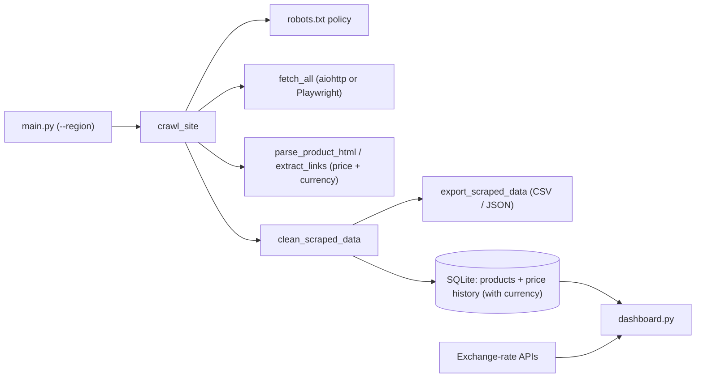

# Async Web Scraper & Data Pipeline

A configurable product scraper with async fetching, optional headless-browser rendering, structured-data extraction, a robots-aware crawler, region and currency awareness, CSV/JSON export, SQLite persistence with price history, and a Streamlit dashboard with live currency conversion.

The default target is [books.toscrape.com](https://books.toscrape.com), a sandbox built for scraping practice. Large retailers block automated clients and restrict them in their terms, so test against sites you are allowed to scrape.

---

## Features

- Async fetching with retries (429/5xx only, `Retry-After` honored) and a concurrency limit
- Best-first, same-host crawler with page, depth, and concurrency limits
- `robots.txt` checks, including crawl-delay handling
- Extraction from Schema.org Product JSON-LD, Open Graph, microdata, CSS-class star ratings, and common storefront markup
- Optional Playwright rendering for JavaScript-heavy storefronts
- **Region support:** `--region` sends regional language hints (`Accept-Language` and browser locale) and sets a fallback currency
- **Currency detection:** each product's currency is read from JSON-LD, meta tags, or the price text (symbol or ISO code), and stored with the price
- Cleaning step that drops invalid rows, normalizes currency codes, and deduplicates by URL
- SQLite persistence: new products are inserted, existing ones get their price, currency, title, rating, and image refreshed
- Price history table with one row per price or currency change
- Streamlit dashboard: display-currency selector with live conversion, filters, KPIs, price trends, deal alerts, catalog view, currency converter, CSV/Excel download
- CSV/JSON export alongside the database
- Unit tests for parsing and cleaning logic

---

## Architecture



| Path | Responsibility |
|---|---|
| `main.py` | CLI entry point and pipeline orchestration |
| `core/crawler.py` | robots policy, best-first crawl, crawl diagnostics |
| `core/fetcher.py` | HTTP fetching, retries, TLS, regional `Accept-Language`, aligned results |
| `core/browser.py` | Playwright rendering with one shared browser and regional locale |
| `core/parser.py` | Product parsing, currency detection, and link classification |
| `core/regions.py` | Supported regions: country code, currency, locale, `Accept-Language` |
| `core/currency.py` | Currency symbols/formatting, exchange-rate download, conversion (standard library only) |
| `utils/processor.py` | Cleaning, currency normalization, deduplication, CSV/JSON export |
| `data/models/database.py` | SQLAlchemy models, engine, and the automatic `currency` column migration |
| `dashboard.py` | Streamlit dashboard |

---

## Quick start

```bash
python -m venv .venv
.venv\Scripts\activate
pip install -r requirements.txt
pip install certifi
```

`certifi` gives Python a reliable CA bundle for HTTPS (fixes certificate errors on Windows and macOS). Optional extras: `brotli` (brotli-compressed responses), `openpyxl` (dashboard Excel export), `playwright` (JavaScript rendering).

Scrape the default sandbox site, then open the dashboard:

```bash
python main.py --max-products 50 --max-pages 80
streamlit run dashboard.py
```

---

## Usage

Start from any listing, category, search-results, or product URL on the site you want:

```bash
python main.py --base-url "https://shop.example/category/cameras" --max-products 20 --max-pages 100 --crawl-depth 2 --max-concurrency 5 --output csv
```

If a site's search URL accepts a query, use the `{query}` placeholder (`--query` is only used in this case):

```bash
python main.py --query cameras --base-url "https://shop.example/search?q={query}" --max-products 20
```

For JavaScript-heavy storefronts, render pages in a headless browser:

```bash
pip install playwright
python -m playwright install chromium
python main.py --base-url "https://shop.example/category/cameras" --max-products 10 --render-js --wait-seconds 3
```

To scrape for a specific region (language hints plus a fallback currency):

```bash
python main.py --base-url "https://shop.example/category/cameras" --region CI --max-products 20
```

### Options

| Option | Default | Description |
|---|---|---|
| `--base-url` | `https://books.toscrape.com` | Start URL; supports `{query}` |
| `--query` | `headphones` | Search term, used only when `--base-url` contains `{query}` |
| `--max-products` | `10` | Maximum products to save; `0` uses the page limit |
| `--max-pages` | `100` | Maximum pages visited per run |
| `--crawl-depth` | `2` | Link levels to follow; products need at least `1` |
| `--max-concurrency` | `10` | Maximum concurrent requests |
| `--output` | `db` | `db`, `csv`, or `json`; the database is always written, csv/json add an export |
| `--output-dir` | `data` | Folder for exported files |
| `--user-agent` | built-in | Custom User-Agent string; an honest one such as `MyScraper/1.0 (+you@example.com)` is recommended |
| `--render-js` | off | Render pages with Playwright |
| `--wait-seconds` | `2.0` | Extra wait after load for rendered pages |
| `--region` | empty (site default) | Country code for language and currency hints, for example `CI`, `FR`, `US` |

### Supported regions

| Code | Country | Fallback currency |
|---|---|---|
| `CI` | Côte d'Ivoire | XOF |
| `SN` | Senegal | XOF |
| `CM` | Cameroon | XAF |
| `NG` | Nigeria | NGN |
| `GH` | Ghana | GHS |
| `KE` | Kenya | KES |
| `ZA` | South Africa | ZAR |
| `MA` | Morocco | MAD |
| `FR` | France | EUR |
| `DE` | Germany | EUR |
| `GB` | United Kingdom | GBP |
| `US` | United States | USD |
| `CA` | Canada | CAD |
| `AU` | Australia | AUD |
| `IN` | India | INR |
| `BR` | Brazil | BRL |
| `JP` | Japan | JPY |

To add a region, append a `Region(...)` entry to `core/regions.py`. To add a currency symbol or format, edit `CURRENCY_INFO` in `core/currency.py`.

### Environment variables (`.env`)

| Variable | Purpose |
|---|---|
| `USER_AGENT` | Default User-Agent string |
| `DATABASE_URL` | Overrides the SQLite location. The dashboard reads `data/database.db`, so change `DB_PATH` in `dashboard.py` too if you set this |
| `SQL_ECHO` | Set to `1` to log every SQL statement |

---

## How regions and currencies work

1. `--region` sets the `Accept-Language` header for HTTP requests, and the browser locale (plus the same header) for Playwright rendering.
2. The parser then determines each product's currency in this order: JSON-LD `priceCurrency`, price meta tags (`product:price:currency`, `og:price:currency`, `itemprop`), a symbol or ISO code in the price text (for example `12 500 FCFA` or `£12.99`), the region's currency, and finally `USD`.
3. A bare `$` is ambiguous, so the region's currency is used as a tiebreaker for dollar-like regions (for example CAD or AUD). `FCFA` becomes `XAF` when the region is Cameroon, otherwise `XOF`.
4. The currency is stored with every product and every price-history row. Converting happens only in the dashboard, so the stored data always shows what the site actually returned.

**Limitation:** a region hint only changes the currency on sites that honor it. Many shops choose the currency from the visitor's IP address and ignore language headers. That is why the scraper records the currency the site really returned instead of assuming the region's.

---

## How crawling works

1. The crawler loads `robots.txt` once. A missing file (404/410) allows everything. A `401`, `403`, `429`, or `5xx` response, or an unreachable server, stops the crawl.
2. Pages are fetched best-first: product links, then pagination ("next page") links, then everything else.
3. Pagination stays at the same depth, so `--crawl-depth 1` means "every listing page plus the products they link to".
4. A page is recorded only if a parent page linked it as a product, or the page declares itself a product (JSON-LD, `og:type`, price meta or `itemprop`). Start pages, listings, and info pages are never recorded.
5. The crawler stays on the starting host (`example.com` and `www.example.com` count as the same site), skips assets and `nofollow` links, and strips tracking parameters from URLs.

---

## Data storage

- The default database is `<project>/data/database.db`, resolved from the project folder, so the scraper and dashboard use the same file wherever you launch them from.
- `products` has a unique `url` and a `currency` column. Re-running the pipeline inserts new products and refreshes the title, price, currency, rating, and image of existing ones.
- `product_price_history` gets one row each time a product's price **or currency** changes, which feeds the dashboard's trend charts. Each row stores its own currency.
- **Automatic migration:** on startup, `init_db` adds the `currency` column to existing SQLite databases (`ALTER TABLE ... DEFAULT 'USD'`). Old rows therefore show as `USD` until each product is scraped again. For PostgreSQL or MySQL, add the column with Alembic or by hand.
- CSV/JSON exports are written to `data/products.csv` or `data/products.json` (including a `currency` column) and overwritten on each run.
- The dashboard reads the database first and falls back to `data/products.csv` when the database is empty. The CSV has no `created_at` or price history, and rows without a currency are treated as `USD`.

---

## Dashboard

```bash
streamlit run dashboard.py
```

Tabs: overview charts, price trends, deal alerts, a table/card catalog with CSV and Excel download, and a currency converter.

- **Display currency:** choose it in the sidebar. Every KPI, chart, table, deal alert, and price-history line is converted per row from each product's own currency, so mixed-currency databases stay correct. Tables and cards show the original price next to the converted one, and exports include both.
- **Deal alerts:** the default price ceiling scales with the chosen currency (it starts from the equivalent of 75 USD).
- **Converter tab:** convert any amount between two currencies, swap them with one click, and see a table of popular currencies.
- **Exchange rates:** downloaded live from public rate APIs and cached for one hour. If the download fails, the dashboard keeps working and shows only prices already in the selected currency. It retries at most once a minute, and **Refresh data** forces a new attempt. XOF and XAF fall back to their fixed euro peg (655.957) if the API lacks them.
- **Scrape panel:** pick a region (language and currency hint) before starting a scrape. The result message lists the currencies detected.

Converted prices use live mid-market rates and are indicative only.

---

## Troubleshooting

Run `main.py` from a terminal. The crawl summary, detected currencies, and warnings are printed as they happen.

| Symptom | Likely cause |
|---|---|
| `robots.txt returned HTTP 403/429` | The site is blocking bots or rate-limiting you. Use an official API or ask for permission; do not work around it |
| `Every request failed` | Network or TLS problem. Run `pip install certifi`, then check the warnings above the summary |
| Pages visited, `0 products` | The site renders prices with JavaScript (add `--render-js`), or it needs site-specific selectors |
| Only the start page is visited | Raise `--crawl-depth` to at least `1` and `--max-pages` to cover the catalog (each listing page costs one page and yields about 20 products on the sample site) |
| Dashboard shows old or no data | It is reading the CSV fallback, or `DATABASE_URL` points elsewhere. Delete `data/database.db` and `data/products.csv`, then re-run the scraper |
| `playwright is not installed` or a missing-browser error | `pip install playwright`, then `python -m playwright install chromium` |
| `TypeError: new_context() got an unexpected keyword argument 'accept_language'` | Playwright has no such argument. Use `locale=` and `extra_http_headers={"Accept-Language": ...}`, as in `core/browser.py` |
| Prices show the wrong currency | The site ignored the region hint and the page has no currency markup, so the region fallback was used. Run without `--region`, or check the `Detected currencies:` log line |
| Everything shows as `USD` after upgrading | Old rows keep the migration default. Re-run the scraper to refresh each product's currency |
| Dashboard warns that live rates are unavailable | The rate APIs are unreachable. Check your connection and click **Refresh data** |
| `ModuleNotFoundError: core` when starting the dashboard | Run it from the project folder: `streamlit run dashboard.py` |

---

## Testing

```bash
python -m unittest discover -s tests -v
```

---

## Limitations and responsible use

No generic scraper can extract every site: some use custom markup, require login, block automated access, or load data through private APIs. Use site-specific selectors or adapters for those cases. The crawler does not bypass authentication, paywalls, CAPTCHAs, or access controls. Region hints are requests, not guarantees, and the crawler never tries to disguise its location.

Only scrape sites you are permitted to, respect `robots.txt` and the site's terms, keep concurrency modest, and identify your scraper honestly.