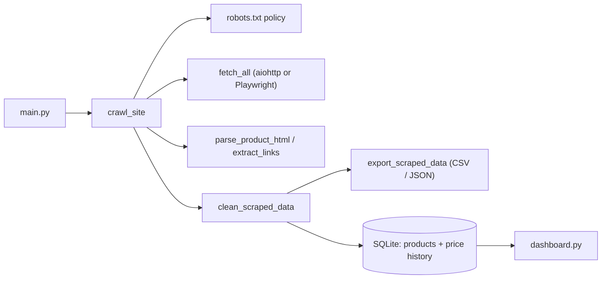

# Async Web Scraper & Data Pipeline

A configurable product scraper with async fetching, optional headless-browser rendering, structured-data extraction, a robots-aware crawler, CSV/JSON export, SQLite persistence with price history, and a Streamlit dashboard.

The default target is [books.toscrape.com](https://books.toscrape.com), a sandbox built for scraping practice. Large retailers block automated clients and restrict them in their terms, so test against sites you are allowed to scrape.

---

## Features

- Async fetching with retries (429/5xx only, `Retry-After` honored) and a concurrency limit
- Best-first, same-host crawler with page, depth, and concurrency limits
- `robots.txt` checks, including crawl-delay handling
- Extraction from Schema.org Product JSON-LD, Open Graph, microdata, CSS-class star ratings, and common storefront markup
- Optional Playwright rendering for JavaScript-heavy storefronts
- Cleaning step that drops invalid rows and deduplicates by URL
- SQLite persistence: new products are inserted, existing ones get their price, title, rating, and image refreshed
- Price history table with one row per price change
- Streamlit dashboard: filters, KPIs, price trends, deal alerts, catalog view, CSV/Excel download
- CSV/JSON export alongside the database
- Unit tests for parsing and cleaning logic

---

## Architecture



| Path | Responsibility |
|---|---|
| `main.py` | CLI entry point and pipeline orchestration |
| `core/crawler.py` | robots policy, best-first crawl, crawl diagnostics |
| `core/fetcher.py` | HTTP fetching, retries, TLS, aligned results |
| `core/browser.py` | Playwright rendering with one shared browser |
| `core/parser.py` | Product parsing and link classification |
| `utils/processor.py` | Cleaning, deduplication, CSV/JSON export |
| `data/models/database.py` | SQLAlchemy models and engine |
| `dashboard.py` | Streamlit dashboard |

---

## Quick start

```bash
python -m venv .venv
.venv\Scripts\activate
pip install -r requirements.txt
pip install certifi
```

`certifi` gives Python a reliable CA bundle for HTTPS (fixes certificate errors on Windows and macOS). Optional extras: `brotli` (brotli-compressed responses), `openpyxl` (dashboard Excel export), `playwright` (JavaScript rendering).

Scrape the default sandbox site, then open the dashboard:

```bash
python main.py --max-products 50 --max-pages 80
streamlit run dashboard.py
```

---

## Usage

Start from any listing, category, search-results, or product URL on the site you want:

```bash
python main.py --base-url "https://shop.example/category/cameras" --max-products 20 --max-pages 100 --crawl-depth 2 --max-concurrency 5 --output csv
```

If a site's search URL accepts a query, use the `{query}` placeholder (`--query` is only used in this case):

```bash
python main.py --query cameras --base-url "https://shop.example/search?q={query}" --max-products 20
```

For JavaScript-heavy storefronts, render pages in a headless browser:

```bash
pip install playwright
python -m playwright install chromium
python main.py --base-url "https://shop.example/category/cameras" --max-products 10 --render-js --wait-seconds 3
```

### Options

| Option | Default | Description |
|---|---|---|
| `--base-url` | `https://books.toscrape.com` | Start URL; supports `{query}` |
| `--query` | `headphones` | Search term, used only when `--base-url` contains `{query}` |
| `--max-products` | `10` | Maximum products to save; `0` uses the page limit |
| `--max-pages` | `100` | Maximum pages visited per run |
| `--crawl-depth` | `2` | Link levels to follow; products need at least `1` |
| `--max-concurrency` | `10` | Maximum concurrent requests |
| `--output` | `db` | `db`, `csv`, or `json`; the database is always written, csv/json add an export |
| `--output-dir` | `data` | Folder for exported files |
| `--user-agent` | built-in | Custom User-Agent string; an honest one such as `MyScraper/1.0 (+you@example.com)` is recommended |
| `--render-js` | off | Render pages with Playwright |
| `--wait-seconds` | `2.0` | Extra wait after load for rendered pages |

### Environment variables (`.env`)

| Variable | Purpose |
|---|---|
| `USER_AGENT` | Default User-Agent string |
| `DATABASE_URL` | Overrides the SQLite location. The dashboard reads `data/database.db`, so change `DB_PATH` in `dashboard.py` too if you set this |
| `SQL_ECHO` | Set to `1` to log every SQL statement |

---

## How crawling works

1. The crawler loads `robots.txt` once. A missing file (404/410) allows everything. A `401`, `403`, `429`, or `5xx` response, or an unreachable server, stops the crawl.
2. Pages are fetched best-first: product links, then pagination ("next page") links, then everything else.
3. Pagination stays at the same depth, so `--crawl-depth 1` means "every listing page plus the products they link to".
4. A page is recorded only if a parent page linked it as a product, or the page declares itself a product (JSON-LD, `og:type`, price meta or `itemprop`). Start pages, listings, and info pages are never recorded.
5. The crawler stays on the starting host (`example.com` and `www.example.com` count as the same site), skips assets and `nofollow` links, and strips tracking parameters from URLs.

---

## Data storage

- The default database is `<project>/data/database.db`, resolved from the project folder, so the scraper and dashboard use the same file wherever you launch them from.
- `products` has a unique `url`. Re-running the pipeline inserts new products and refreshes the title, price, rating, and image of existing ones.
- `product_price_history` gets one row each time a product's price changes, which feeds the dashboard's trend charts.
- CSV/JSON exports are written to `data/products.csv` or `data/products.json` and overwritten on each run.
- The dashboard reads the database first and falls back to `data/products.csv` when the database is empty. The CSV has no `created_at` or price history.

---

## Dashboard

```bash
streamlit run dashboard.py
```

Tabs: overview charts, price trends, deal alerts, and a table/card catalog with CSV and Excel download. The sidebar shows the data source and the last scrape time.

---

## Troubleshooting

Run `main.py` from a terminal. The crawl summary and warnings are printed as they happen.

| Symptom | Likely cause |
|---|---|
| `robots.txt returned HTTP 403/429` | The site is blocking bots or rate-limiting you. Use an official API or ask for permission; do not work around it |
| `Every request failed` | Network or TLS problem. Run `pip install certifi`, then check the warnings above the summary |
| Pages visited, `0 products` | The site renders prices with JavaScript (add `--render-js`), or it needs site-specific selectors |
| Only the start page is visited | Raise `--crawl-depth` to at least `1` and `--max-pages` to cover the catalog (each listing page costs one page and yields about 20 products on the sample site) |
| Dashboard shows old or no data | It is reading the CSV fallback, or `DATABASE_URL` points elsewhere. Delete `data/database.db` and `data/products.csv`, then re-run the scraper |
| `playwright is not installed` or a missing-browser error | `pip install playwright`, then `python -m playwright install chromium` |

---

## Testing

```bash
python -m unittest discover -s tests -v
```

---

## Limitations and responsible use

No generic scraper can extract every site: some use custom markup, require login, block automated access, or load data through private APIs. Use site-specific selectors or adapters for those cases. The crawler does not bypass authentication, paywalls, CAPTCHAs, or access controls.

Only scrape sites you are permitted to, respect `robots.txt` and the site's terms, keep concurrency modest, and identify your scraper honestly.